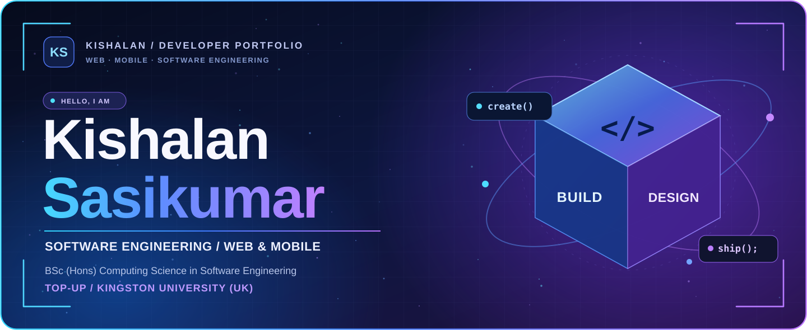
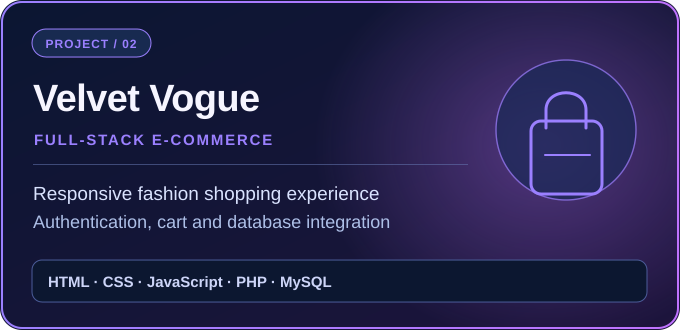
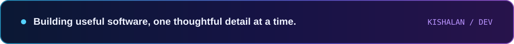

<!--
  KISHALAN SASIKUMAR | ULTRA PREMIUM GITHUB PROFILE • VERSION 2
  Royal Purple × Rich Blue × Electric Cyan
  Place all SVGs in the assets/ directory beside this README.md.
  Profile repository name: kishalansasikumar-star
-->

  

   

  
  
  

    

  
  
  

 

### 01 / THE PERSON BEHIND THE CODE

## ✦ About me

I'm **Kishalan Sasikumar**, a software engineering undergraduate based in Sri Lanka. I enjoy turning ideas into useful web and mobile applications, with attention to clean interfaces, practical features, and user experience.

I'm currently pursuing a **BSc (Hons) Computing Science in Software Engineering (Top-Up)** at **Kingston University (UK)**, following an **HND in Computing (Software Engineering)** at ESOFT Metro Campus.

<table>
  <tr>
    <td width="50%" valign="top">
      <h3>🎓 Current chapter</h3>
      <strong>Kingston University (UK)</strong> 
      BSc (Hons) Computing Science in Software Engineering <strong>(Top-Up)</strong>.  
      <strong>Previous qualification</strong> 
      HND in Computing (Software Engineering), ESOFT Metro Campus.
    </td>
    <td width="50%" valign="top">
      <h3>🚀 What I'm building</h3>
      <strong>HealthMate — Personal Health &amp; Wellness Tracker</strong> 
      A React Native application using Expo, TypeScript, and local SQLite storage.  
      <strong>Interests</strong> 
      Mobile apps · Full-stack web · UI/UX · Practical software solutions
    </td>
  </tr>
</table>

 

### 02 / THE TECHNOLOGIES

## ✦ Engineering toolkit

  

<strong>Explore my tech stack in detail</strong>

 

**Mobile development**

**Frontend**

**Backend, data & design**

 

### 03 / THE WORK

## ✦ Selected projects

<table>
  <tr>
    <td width="50%" valign="top">
      
      
<a href="https://github.com/kishalansasikumar-star/HealthMate"><strong>View HealthMate repository</strong></a>

    </td>
    <td width="50%" valign="top">
      
      
<strong>Velvet Vogue</strong> · E-commerce project

    </td>
  </tr>
  <tr>
    <td width="50%" valign="top">
      
      
<a href="https://kishalan.netlify.app/"><strong>Visit portfolio</strong></a>

    </td>
    <td width="50%" valign="top">
      
      
<a href="https://strong-gym-center.netlify.app/"><strong>Visit Strong Gym Center</strong></a>

    </td>
  </tr>
</table>

<strong>More work — design & business intelligence</strong>

 

- **Fresh Groceries** — A grocery shopping interface and interactive prototype designed with Figma.
- **Food City Business Intelligence Dashboard** — A sales and inventory reporting dashboard developed with Microsoft Power BI and Python Pandas.

 

### 04 / THE JOURNEY IN CODE

## ✦ GitHub activity

  
  

   

  

GitHub activity graphics use third-party services and can occasionally be unavailable. Language stats reflect public repositories, not overall experience.

 

### 05 / THE NEXT CONNECTION

## ✦ Let's connect

I'm always interested in learning, exchanging ideas, and building useful software. Explore my projects or get in touch.

  <a href="https://kishalan.netlify.app/"><strong>Portfolio</strong></a>
  &nbsp; · &nbsp;
  <a href="https://www.linkedin.com/in/kishalan-sasikumar-730892419/"><strong>LinkedIn</strong></a>
  &nbsp; · &nbsp;
  <a href="mailto:kishalansasikumar@gmail.com"><strong>Email</strong></a>

  

