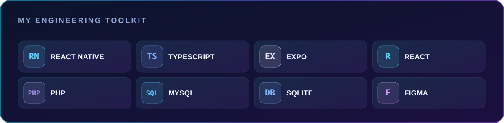
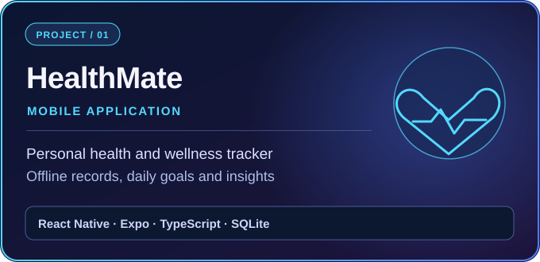
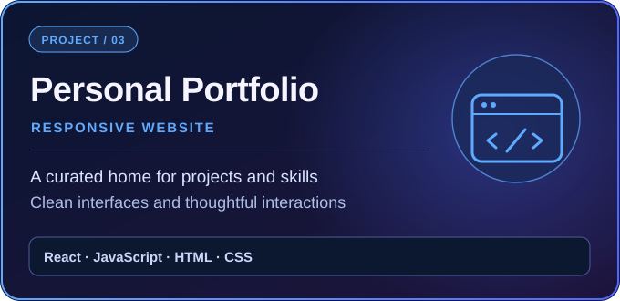
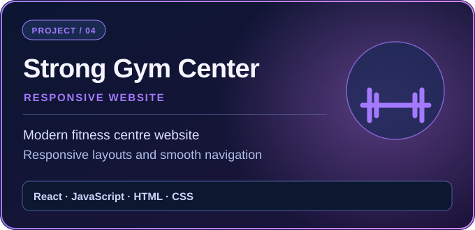

<!--
KISHALAN SASIKUMAR
ULTRA PREMIUM GITHUB PROFILE — V3
Theme: Royal Purple × Deep Navy × Electric Cyan
Repository: kishalansasikumar-star
-->

<div align="center">


<br/>

<a href="https://git.io/typing-svg">

</a>

<br/>

<a href="https://kishalan.netlify.app/">

</a>
<a href="https://www.linkedin.com/in/kishalan-sasikumar-730892419/">

</a>
<a href="mailto:kishalansasikumar@gmail.com">

</a>

<br/><br/>


</div>

<br/>

---

### 01 / INTRODUCTION

## ✦ The person behind the code

<table>
<tr>
<td width="55%" valign="top">

### Hello, I'm Kishalan 👋

I'm **Kishalan Sasikumar**, a software engineering undergraduate from Sri Lanka.

I enjoy building modern web and mobile applications with clean designs, useful features, and smooth user experiences.

Currently pursuing a **BSc (Hons) Computing Science in Software Engineering (Top-Up)** at **Kingston University (UK)**.

Previously completed an **HND in Computing (Software Engineering)** at **ESOFT Metro Campus**.

**Current interests**

- Mobile application development
- Full-stack web development
- UI/UX design
- Practical software solutions
- Learning new technologies

</td>
<td width="45%" valign="top">

### Developer profile

```yaml
name: Kishalan Sasikumar
location: Sri Lanka

education:
  - BSc (Hons) Computing Science
  - HND Software Engineering

focus:
  - Mobile Development
  - Full Stack Web
  - UI/UX Design

currently_building:
  - HealthMate

mindset: Learn • Build • Improve
```

</td>
</tr>
</table>

<br/>

---

### 02 / TECHNOLOGY

## ✦ Engineering toolkit

<div align="center">



<br/><br/>


</div>

<details>
<summary><b>⚡ Explore the complete technology stack</b></summary>

<br/>

**Mobile development**


**Frontend development**


**Backend and databases**


**Design and tools**


</details>

<br/>

---

### 03 / FEATURED WORK

## ✦ Selected projects

<div align="center">

<table>
<tr>
<td width="50%" align="center">

<a href="https://github.com/kishalansasikumar-star/HealthMate">

</a>

**HealthMate**

React Native • Expo • TypeScript • SQLite

[Explore Repository](https://github.com/kishalansasikumar-star/HealthMate)

</td>

<td width="50%" align="center">


**Velvet Vogue**

Full-Stack E-Commerce Website

Fashion Shopping Platform

</td>
</tr>

<tr>
<td width="50%" align="center">

<a href="https://kishalan.netlify.app/">

</a>

**Personal Portfolio**

Responsive Web Development

[Live Website](https://kishalan.netlify.app/)

</td>

<td width="50%" align="center">

<a href="https://strong-gym-center.netlify.app/">

</a>

**Strong Gym Center**

Responsive Fitness Website

[Live Website](https://strong-gym-center.netlify.app/)

</td>
</tr>
</table>

</div>

<details>
<summary><b>🚀 Explore additional projects</b></summary>

<br/>

**Fresh Groceries**

A grocery shopping interface and interactive prototype created using Figma.

**Food City Business Intelligence Dashboard**

A sales and inventory dashboard developed with Microsoft Power BI and Python Pandas.

</details>

<br/>

---

### 04 / GITHUB ANALYTICS

## ✦ My development journey

<div align="center">


<br/><br/>


<br/><br/>


</div>

<br/>

---

### 05 / CONNECTIONS

## ✦ Let's build something meaningful

<div align="center">

I'm always interested in learning new technologies, sharing ideas, and creating useful applications.

<br/>

<a href="https://kishalan.netlify.app/">

</a>

<a href="https://www.linkedin.com/in/kishalan-sasikumar-730892419/">

</a>

<a href="mailto:kishalansasikumar@gmail.com">

</a>

<br/><br/>


<br/>

<a href="https://git.io/typing-svg">

</a>

</div>
